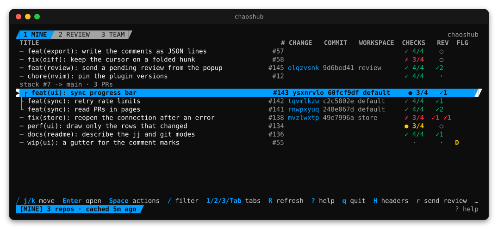
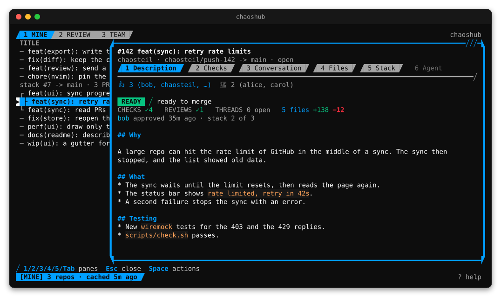
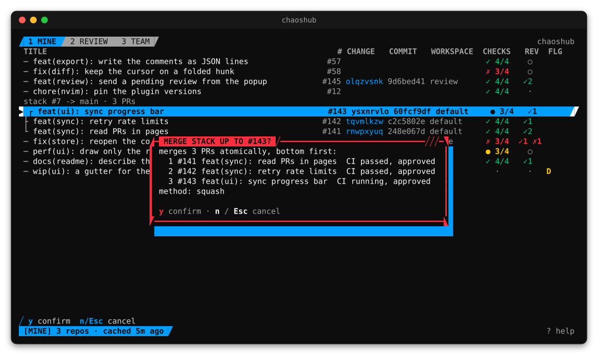

# chaoshub

chaoshub is a terminal app that tracks your GitHub pull requests (PRs).
It shows your own PRs as stacks next to your local jj changes or git
branches. It also shows the PRs that wait for your review, and the
other PRs of your team. From one list, you read a PR, review it in
codeview, approve it and merge it, also a full stack.

chaoshub is for developers who work in the terminal and keep many PRs
open in a few repos. jj is recommended, but every feature also works
with git only.

## Screenshots

The screenshots show made-up PRs.

The Mine tab: a stack of 3 PRs and single PRs, with their CI and review
states and the local jj changes.



The PR view of a PR in the stack, on the Description pane.



The confirm popup of a merge of the whole stack.



## Features

- Three tabs: Mine has your own PRs. Review has the PRs that request
  your review or the review of your team. Team has the other PRs of your
  colleagues. By default, Review and Team show only the PRs that are
  ready for review.
- Stacks and local changes: the Mine tab shows each GitHub stack as a
  tree. Each PR shows its local change, commit and workspace, and tells
  you when the local change and the PR diverged.
- The state at a glance: columns show the CI checks, the reviews,
  drafts, merge conflicts and the merge queue. A fuzzy filter finds a PR
  in each tab. `space` then `u` opens a pasted PR link.
- The PR view: one PR in six panes. The panes are the description with
  a readiness block, the checks, the conversation with replies and
  reactions, the changed files with syntax colors, the stack, and the
  agent results.
- Reviews in codeview: `v` opens the PR in
  [codeview](https://github.com/chaosteil/codeview) in nvim. The Review
  popup then sends your comments with an approval, a change request or a
  comment review.
- Merges: merge one PR, or merge a full stack from any of its entries.
  You can also run failed checks again, mark a draft ready, or close a
  PR. A change pulses until GitHub shows it.
- AI review: run
  [Open Code Review](https://github.com/alibaba/open-code-review) or
  [pr-agent](https://github.com/qodo-ai/pr-agent) on a PR. The result
  stays on your disk until you take it as your own.
- Rex and Ghostty: inside Rex, the PR view and codeview open in panes
  beside the list, and questions can open in the Rex palette. Rex and
  Ghostty tabs show what chaoshub does, and a notice tells you when new
  PRs are ready for review. Rex resumes the list and its PR view panes
  after a restart.
- A fast start: a local cache shows the last lists at once. chaoshub
  then syncs with GitHub in the background.

## Install

chaoshub runs on macOS and Linux.

```sh
brew install chaosteil/tap/chaoshub     # Homebrew
cargo install --locked chaoshub         # Cargo, needs Rust 1.91 or later
cargo binstall chaoshub                 # cargo-binstall, no compile
nix profile install github:chaosteil/chaoshub   # Nix
```

You also need these programs:

- `git` and `gh` (the GitHub CLI) on your `PATH`. Run `gh auth login`
  once.
- Optional: `jj`, nvim with the codeview plugin, Rex, and Open Code
  Review or pr-agent.

For `.deb` and `.rpm` packages, prebuilt archives, the Nix flake input,
a build from source and the full requirements, see
[Install](https://github.com/chaosteil/chaoshub/blob/main/docs/install.md).

## Quick start

1. Log in to GitHub with `gh auth login`.
2. Go to a local checkout of a GitHub repo, and start chaoshub:

   ```sh
   chaoshub
   ```

3. Press `?` to see every key. Press `enter` on a PR to open the PR
   view, and `space` to open the actions menu.

To track more repos, write `~/.config/chaoshub/config.toml`:

```toml
teams = ["my-org/my-team"]

[[repo]]
name = "chaosteil/chaoshub"
path = "~/code/chaoshub"

[[repo]]
name = "my-org/deploy"
```

A repo with a `path` also shows your local changes, and gets the
codeview review and the AI review. Every key has a default, so you can
start without a file. For every key, see
[Configuration](https://github.com/chaosteil/chaoshub/blob/main/docs/configuration.md).

## Documentation

| Page | What it tells |
|---|---|
| [Install](https://github.com/chaosteil/chaoshub/blob/main/docs/install.md) | The requirements, jj and git, and each way to install chaoshub. |
| [Usage](https://github.com/chaosteil/chaoshub/blob/main/docs/usage.md) | The tabs, the list columns, the filter, the keys, the mouse and the command line. |
| [The PR view](https://github.com/chaosteil/chaoshub/blob/main/docs/pr-view.md) | The panes of one PR, replies, reactions and diffs. |
| [Actions and reviews](https://github.com/chaosteil/chaoshub/blob/main/docs/actions.md) | The actions, the stack merge and the Review popup. |
| [Configuration](https://github.com/chaosteil/chaoshub/blob/main/docs/configuration.md) | Every key of `config.toml`. |
| [Review agents](https://github.com/chaosteil/chaoshub/blob/main/docs/review-agents.md) | The AI review with Open Code Review or pr-agent. |
| [Rex, Ghostty and the terminal](https://github.com/chaosteil/chaoshub/blob/main/docs/rex.md) | The Rex panes and palette, the terminal title, the status and the notices. |
| [Development](https://github.com/chaosteil/chaoshub/blob/main/docs/development.md) | The checks, how to extend chaoshub, the benchmark and the screenshots. |

## License

chaoshub is licensed under either of these licenses, at your option:

- Apache License, Version 2.0 ([LICENSE-APACHE](https://github.com/chaosteil/chaoshub/blob/main/LICENSE-APACHE) or
  <https://www.apache.org/licenses/LICENSE-2.0>)
- MIT license ([LICENSE-MIT](https://github.com/chaosteil/chaoshub/blob/main/LICENSE-MIT) or
  <https://opensource.org/licenses/MIT>)

Unless you explicitly state otherwise, any contribution intentionally
submitted for inclusion in the work by you, as defined in the
Apache-2.0 license, shall be dual licensed as above, without any
additional terms or conditions.
